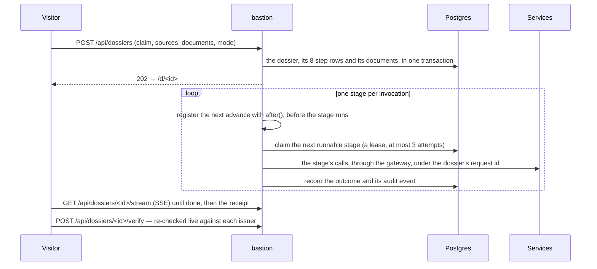

# 🏰 `bastion`

> 🧾 **Eight products, operated live, chained into one receipt.**
> Run every muizz-lab product from one place with no sign-in, chain them into a dossier whose every piece of evidence is scraped or read exactly, signed, argued over, measured and sealed — then let anyone re-verify it, live, without trusting bastion.

🌐 [Live](https://bastion-six.vercel.app) · ❓ [Why](WHY.md) · 🏗️ [Architecture](docs/ARCHITECTURE.md) · 🎬 [Demo](docs/DEMO.md) · 📐 [Spec](docs/specs/21-bastion-v2.md) · 🔐 [Token contract](docs/specs/22-platform-contract-v2.md)


[](https://github.com/Abdul-Muizz1310/bastion/actions/workflows/ci.yml)


---

```text
claim     "The USPTO basic filing fee for a utility patent is 350 dollars."
          ──────────────────────────────────────────────────────────────────────────────
wake      the services this dossier needs, held up to 90 s each           bastion
gather    web pages, scraped live                                         magpie
read      a PDF's passages and exact tables, each with its page and box   inkthread · inkgrid
seal      one Ed25519 certificate per evidence item, at most 12           inkprint
debate    proponent, skeptic and judge, over the sealed evidence first    paper-trail
measure   every query the run caused, found by its request id             slowquery
envelope  one signed envelope over every receipt above                    inkprint
record    the digest of the run's slice of the append-only audit log      bastion
          ──────────────────────────────────────────────────────────────────────────────
verify    certificates · transcript · envelope · perf · audit · documents · steps
          each re-checked live against the service that issued it: pass, fail, unavailable or expired
```

---

## 💡 Why this exists

Every muizz-lab product shares one brand promise: **tools that hand you a receipt** — a signed certificate, a signed transcript, a verification report, an exact `CREATE INDEX`. Each one proves something on its own. bastion is what they become together: the receipt of receipts.

- **Operate each product live**, from one place, and keep the receipt it hands back. No sign-in: a visitor is a daily pseudonym, never an account.
- **Chain them into a dossier**: a claim checked against web pages and PDFs, every piece of evidence signed before the debate sees it, the debate signed, the queries it caused measured, and everything sealed into one envelope.
- **Verify any dossier later**, at a public URL. Every signature and hash is re-checked against the issuer's own published key, and nothing that could not be checked ever reads as a pass.

bastion v1 was a signed-in control plane that proved four services answered. v2 removes sign-in entirely and makes all eight products usable — inkthread and inkgrid included — under budgets that keep a free-tier platform alive ([WHY.md](WHY.md)).

---

## 🧩 The eight products

| Product | Operate it in bastion | The receipt it hands back |
|---|---|---|
| 🐦 **magpie** | Pick a source, scrape once; browse items; heal history | Item content hashes; self-heal PR links |
| 🧮 **inkgrid** | A sample PDF or an upload: exact tables as cell grids, text, findings | The verification report (a second PDF engine agrees) |
| 🧵 **inkthread** | The same document as a graph coloured by role; the why of any element; its page with the box drawn | `graph_hash`; the rule or model behind each element |
| 🖋️ **inkprint** | Certify text, verify a certificate, diff against a parent, run a leak scan | An Ed25519 certificate with a C2PA manifest; the verify checks |
| ⚖️ **paper-trail** | Debate a claim; rounds appear as they finish | The transcript hash and its Ed25519 signature, checked live |
| 🐢 **slowquery** | The fleet's slowest fingerprints across four services and the demo; the demo's slow/fast branch | The EXPLAIN plan and the exact `CREATE INDEX` |
| 🪶 **feathers** | The YAML that generated feathers-demo; live CRUD on it, then the soft-delete proof | The generated contract: role-gated endpoints, soft delete honoured (a 404) |
| 🏰 **bastion** | The token inspector (decoded claims, never a token) and the JWKS | The audit event for the call |

**How they combine** — exactly the edges on the live system map:

- magpie scrapes web pages live, and inkprint signs each item it brings back.
- inkgrid reads a PDF's tables and text exactly; inkthread maps them into a graph.
- inkthread hands each quoted passage, with its page and its why, to inkprint to sign.
- paper-trail's proponent, skeptic and judge argue over that signed evidence first (cited as `[cert:…]`); paper-trail may search the web for what the pool cannot answer.
- slowquery measures every query magpie, inkthread, inkprint and paper-trail ran for the dossier's request id.
- feathers generated feathers-demo, a live FastAPI service, from one YAML schema.

---

## ✨ Features

- 🗺️ **A live system map** — the 8 products as an inline SVG drawn on the server, health in words beside each node (live, asleep, down, checking, unknown), one shared probe round every 30 s for every visitor
- 🧰 **A workbench per product** — each behind a wake gate that holds a cold Render service for up to 90 s and says asleep, never down, when it does not wake
- 🧾 **Durable dossiers** — eight stages as Postgres rows advanced one per invocation, leased, retried at most 3 times, chained by the runner itself, followed live over SSE
- ✅ **Verify everything** — 7 checks recomputed live: certificates, transcript, envelope, perf, audit, documents, steps; the receipts bundle downloads as canonical JSON
- 🔐 **Platform token contract v2** — Ed25519 tokens bound to an issuer and one audience, 60 s life, enforced by all six backends (spec 22)
- 💸 **Budgets and limits** — daily budgets per UTC day for everything that spends a paid or rationed call; per-visitor rate limits on each visitor's calls to a service, spends and reads of the log
- 📝 **An append-only audit log** — Postgres triggers reject `UPDATE`, `DELETE` and `TRUNCATE` for every role; each dossier's envelope signs the digest of its own slice
- 🔎 **The open log** — `/audit` with filters and a waterfall per request across services; `/time-travel` replays every entity to any moment
- 📇 **The registry** — `/platform`: the 8 products, 15 repos, 6 services with live health and commit SHAs, the token contract, today's budgets

---

## 🏗️ Architecture

```mermaid
flowchart LR
    V([Visitor<br/>no sign-in]) --> Pages[Pages · RSC<br/>map · tools · dossier · d · audit · time-travel · platform]
    V --> API[Route handlers<br/>/api/tools · /api/dossiers · /api/uploads · /api/platform]
    Pages --> API
    API --> GW[Gateway<br/>capability → rate limit → budget → token v2 → call → parse → audit]
    API --> RUN[Runner<br/>one stage per invocation<br/>after() chain]
    RUN --> GW
    GW --> MG[magpie]
    GW --> IT[inkthread · inkgrid]
    GW --> IP[inkprint]
    GW --> PT[paper-trail]
    GW --> SQ[slowquery]
    GW --> FD[feathers-demo]
    GW --> UP[(Upstash<br/>limits · budgets)]
    GW --> DB[(Neon Postgres<br/>append-only events)]
    RUN --> DB
```

Every downstream call — a workbench action, a dossier stage, a verification — goes through **one gateway function** driven by a typed capability table (37 capabilities, `src/capabilities/`). In order: resolve the capability, check the visitor's rate limit, reserve the daily budget, mint a contract-v2 token, call with `X-Request-Id`, parse the answer with the capability's own Zod schema, append an audit event, return a typed result (`ok · asleep · rate_limited · budget_exhausted · downstream_error · invalid_response`).

### A dossier, end to end



| Stage | Calls | Output |
|---|---|---|
| wake | `GET /health` on every service the dossier needs, up to 90 s | which services are live |
| gather | magpie `POST /api/scrape/batch` (skipped with no sources) | web evidence candidates |
| read | inkthread: poll an upload's job, then the graph and the reading (skipped with no documents) | passages and tables with their pages and boxes |
| seal | inkprint `POST /certificates/batch` over at most 12 selected items | a certificate per item |
| debate | paper-trail `POST /debates` with the sealed items as its evidence pool, argued over first (paper-trail may search the web for what the pool cannot answer); poll; fetch the signed transcript | verdict, confidence, transcript hash and signature |
| measure | `GET /_slowquery/queries?request_id=` on every service the dossier called | the perf receipt and its SHA-256 |
| envelope | inkprint `POST /dossiers/envelope` over the certificates, transcript, perf hash and audit digest | an envelope id and signature |
| record | the digest of the dossier's audit events | succeeded |

A stage that waits on a long job (read, debate) polls once per invocation and returns `waiting` for 3 s. After each stage the runner hands the dossier to a fresh invocation with `after()`; that hand-off is registered **before** the stage runs, so a stage longer than the 10 s hand-off window cannot drop it (the e2e suite crosses a 12 s stage to prove it). The dossier's page also nudges a stalled stage, and a failed stage offers "retry from this stage". See [docs/ARCHITECTURE.md](docs/ARCHITECTURE.md).

### Receipts and verification

`POST /api/dossiers/<id>/verify` re-checks everything live and answers each check as **pass**, **fail**, **unavailable** (the issuer could not be asked — never a pass) or **expired** (an upload's graph, gone by design after an hour):

| Check | What it proves |
|---|---|
| certificates | each evidence row's text hashes to its certificate and inkprint's Ed25519 signature verifies with inkprint's published key |
| transcript | the stored transcript equals paper-trail's live copy, hashes to its receipt, its signature verifies, and it carries this dossier's claim and verdict |
| envelope | the envelope names exactly the stored certificates, transcript, perf hash and graph hashes, and inkprint's signature over it verifies |
| perf | the perf receipt recomputes to its hash |
| audit | the digest of the dossier's slice of the log recomputes, at the record bound and at the bound the envelope signed |
| documents | each document's `graph_hash` and `sha256` are unchanged at inkthread |
| steps | the runner's rows are present: exactly one per stage |

The issuers sign Python's `json.dumps(sort_keys=True)` bytes, which bastion rebuilds exactly; fixtures produced by the issuers' own code prove it (`tests/fixtures/receipts/`). `GET /api/dossiers/<id>/receipts` downloads the whole bundle as canonical JSON (RFC 8785).

---

## 🔐 Security posture

| Concern | What bastion does |
|---|---|
| **No sign-in** | No accounts, no cookies. A visitor is `v_` + 10 base32 characters of an HMAC of their address and the UTC date: it changes daily and cannot be reversed. It is the token `sub`, the rate-limit key and the audit actor |
| **Secrets** | Two of bastion's own — a root secret and the Ed25519 signing key. Every purpose-specific key (the visitor ids, the runner's advance tokens) is derived from the root with HKDF-SHA256 |
| **Tokens (contract v2)** | Ed25519 (`EdDSA`), `iss: bastion`, `aud` = the one service called, the capability's grant as `role`, `exp = iat + 60`, a fresh `jti`. Backends allow 10 s of leeway and fail closed without a key. The JWKS is public at `/.well-known/jwks.json` |
| **Budgets** (per UTC day, shared) | debates 4 · uploads 3 · leak scans 10 · scrapes 30 · certificates 200 · feathers writes 50. A downstream 4xx that spent nothing gives the units back. Overridable with `BUDGET_*` |
| **Rate limits** (per visitor) | gateway: free reads 120/min, every other call 30/min · wake 5/min · compose 3/hour · uploads 3/hour · retry 5/hour · verify 5/min · advance 60/min · receipts 30/min · audit and replay reads 60/min each · budgets and token preview 60/min · feathers proof 3/min |
| **Every call audited** | each gateway call that reaches its budget lands in `events` with service, capability, status and latency — never a body; refusals with no side effect (bad input, a rate limit) are logged instead, so the append-only log cannot be grown without bound |
| **Append-only audit** | `UPDATE`, `DELETE` and `TRUNCATE` on `events` are revoked and rejected by triggers, for the owner too (`drizzle/0001_append_only_events.sql`, proven by the integration tier). An owner could drop a trigger, which is why each envelope signs its dossier's slice |
| **Downstream answers** | parsed with Zod, never cast; redirects never followed (they would carry the token); internal errors published as their bare code, never their message |
| **Uploads** | at most 4 MB, `%PDF-` bytes only; inkthread processes and never keeps them. A dossier is public, and the compose form says so before any upload |
| **Headers** | a source-restricting CSP (`'unsafe-inline'` stays until a nonce pipeline exists), `frame-ancestors 'none'`, `X-Frame-Options: DENY`, `nosniff` |

---

## 📁 Project structure

```
bastion/
├── src/
│   ├── proxy.ts                 # security headers on every route; no gating (there is no sign-in)
│   ├── app/                     # routes: / · /tools[/<id>] · /dossier · /d/[id] · /audit[/<id>] · /time-travel · /platform
│   │   └── api/                 # tools, dossiers (+ advance, retry, stream, verify, receipts), uploads, platform/*
│   ├── capabilities/            # one module per product: request builders, Zod schemas, the capability table
│   ├── platform/
│   │   ├── gateway/             # the one call pipeline, token minting, keys, typed results
│   │   ├── registry/            # products, services, health probes, the shared status round
│   │   ├── audit/               # appendEvent and the log's readers
│   │   ├── budget.ts            # daily budgets (Upstash, in-process without it)
│   │   ├── visitor.ts           # the daily pseudonym
│   │   └── secrets.ts           # HKDF key derivation
│   ├── dossier/                 # the runner, its 8 stages, evidence selection, receipt math, verification
│   ├── features/                # page-level code: tools (8 workbenches), dossier, audit, time-travel, platform, health
│   ├── components/              # the system map, receipts, wake gate, graph, page boxes, terminal frame
│   └── lib/                     # Drizzle schema and client, v1 replay, site metadata
├── drizzle/                     # 0000 schema · 0001 append-only triggers · 0002 v2 dossiers (additive)
├── scripts/                     # migrate.mjs (runs inside Vercel builds), generate-keys.mjs
├── tests/
│   ├── unit/                    # Vitest, node environment
│   ├── integration/db/          # real Postgres: append-only, claiming and leases, receipts, verify
│   ├── e2e/                     # Playwright against the built app and a stub of every service
│   └── fixtures/                # recorded downstream answers; receipts signed by the issuers' own code
└── docs/specs/                  # 23 specs; 21 (v2) and 22 (token contract) are current
```

---

## 🚀 Run locally

```bash
git clone https://github.com/Abdul-Muizz1310/bastion.git && cd bastion
pnpm install
cp .env.example .env.local        # DATABASE_URL, IRON_SESSION_PASSWORD, the signing key (node scripts/generate-keys.mjs)
node scripts/migrate.mjs --force  # migrates the database DATABASE_URL names
pnpm dev                          # http://localhost:3000
```

Without Upstash, the daily budgets are counted in-process (per instance, reset on restart) and the rate limits are off: every limiter lets each request through. A warning says each once. The downstream services default to their live Render hosts; each can be pointed elsewhere with `<SERVICE>_BACKEND_URL` (https only). Every variable is listed, with its default, in [`.env.example`](.env.example).

| Script | Does |
|---|---|
| `pnpm dev` / `pnpm build` / `pnpm start` | Next.js; `build` migrates first, but only inside a Vercel build |
| `pnpm test` | the unit tier (Vitest) |
| `pnpm test:coverage` | the unit tier with coverage floors |
| `pnpm test:integration` | the Postgres tier (needs `DATABASE_URL`) |
| `pnpm test:e2e` | Playwright against the stub (needs a build and a local `DATABASE_URL`) |
| `pnpm bench` | gateway token-mint throughput |
| `pnpm lint` / `pnpm format` | Biome |

---

## 🧱 Stack

| Concern | Choice |
|---|---|
| Framework | **Next.js 16** App Router — pages, route handlers, `after()`; no separate backend |
| UI | **React 19**, Tailwind 4, an inline-SVG system map, `d3-force` for the graph layout |
| Language | **TypeScript** strict; **Zod 4** at every boundary |
| Database | **Neon Postgres** via **Drizzle** and postgres.js; append-only triggers on `events` |
| Limits and budgets | **Upstash Redis** (sliding windows, daily counters) |
| Tokens | **Ed25519** via `jose` (contract v2) |
| Tests | **Vitest** (unit, integration), **Playwright** (e2e) |
| Lint and format | **Biome** |
| Hosting | **Vercel**; the products on **Render** |

---

## 🧪 Testing

```bash
pnpm test                 # unit
pnpm test:coverage        # unit + coverage floors
pnpm test:integration     # real Postgres
pnpm test:e2e             # Playwright: built app + stub (tests/e2e/README.md)
```

Measured on 2026-10-21 (Node 24.19, Linux):

| Metric | Value |
|---|---|
| **Unit** | 2,919 tests in 192 files |
| **Coverage** (unit) | 89.6 % lines · 87.6 % statements · 83.9 % branches · 80.6 % functions |
| **Per-module floors** (90 % lines) | `src/capabilities` 100 % · `src/platform` 98.9 % · `src/dossier` 94.2 % |
| **Integration** | 85 tests in 12 files, against a real Postgres (append-only triggers, concurrent claims, receipts, verification) |
| **End to end** | 20 Playwright specs in 6 files against the built app and a stub of every service, 1.8 min (the asleep case waits out the 90 s wake); plus 1 live smoke, run only by hand |
| **Methodology** | Spec-TDD: the spec first (`docs/specs/21-bastion-v2.md` §10 lists the e2e cases), then failing tests, then code |

CI (`.github/workflows/ci.yml`) runs lint and types, the unit tier with coverage, the build, the integration tier against a Postgres service, and the e2e suite. The live smoke (`BASTION_LIVE_SMOKE=1 PLAYWRIGHT_BASE_URL=…`) spends one real debate and never runs in CI.

---

## ⚡ Benchmarks

Every gateway call mints one token, so the signing cost sits on the hot path (`pnpm bench`, 20,000 mints after 500 warm-up, contract-v2 claims):

| Run | Throughput | p50 | p95 | p99 |
|---|---|---|---|---|
| 1 | 3,633 mints/s | 0.269 ms | 0.331 ms | 0.384 ms |
| 2 | 4,558 mints/s | 0.231 ms | 0.312 ms | 0.365 ms |

Measured 2026-10-21 on Node 24.19, linux-x64. A quarter of a millisecond is three to four orders of magnitude below the downstream call it precedes; the 30 calls a minute per visitor is a policy, not a throughput limit. Details: [`benchmarks/README.md`](benchmarks/README.md).

---

## 🧭 Engineering philosophy

| Principle | How it shows up |
|---|---|
| 🔴 **Spec-TDD** | Spec 21 holds every behaviour and case; each task wrote its failing tests first. The e2e suite found a real bug — a hand-off dropped after a long stage — and the fix landed test-first |
| 🚫 **Negative-space programming** | Capabilities, stages, check states and statuses are closed unions; every downstream answer is parsed; a blank or malformed key id, budget or URL fails loudly; an unchecked receipt is never a pass |
| 🏗️ **Separation of concerns** | Pages render; route handlers are thin shells; the gateway is the only door to a service; stages are pure handlers over injected calls |
| 🔤 **Typed everything** | TypeScript strict, Zod at each HTTP and database boundary, one capability table typed end to end |
| 🌊 **Pure core, imperative shell** | Evidence selection, receipt math, canonical JSON, the nudge rule, the wake model and the health classifier are pure; I/O lives at the edges |

---

## ⚠️ Scope & limitations

- **Free tiers set the pace.** Render's free services sleep after 15 minutes and take about a minute to wake; the free models allow 50 requests a day across the whole portfolio, which is why the budgets are low.
- **Budgets are shared.** One visitor can spend the day's debates for everyone; per-visitor quotas would sit on top.
- **Signatures are checked against the issuers' current keys.** Rotating an issuer's key would turn its old dossiers to fail until key history is published.
- **The perf receipt is only as request-scoped as each service.** It lists the queries each service attributes to the dossier's request id; a service not yet on slowquery-detective 0.2 answers with everything it saw.
- **Uploads are gone after an hour** (DR-0029): their quoted passages stay in the dossier, and the documents check reports the graph as expired, not failed.
- **Without Upstash** (local and the e2e run) budgets are per process and rate limits are off.

---

## 🚦 Status

| Milestone | Status |
|---|---|
| v1: signed-in control plane, 5 services | ✅ Live at [bastion-six.vercel.app](https://bastion-six.vercel.app) |
| v2: no sign-in, 8 workbenches, durable dossiers, live verification | ✅ Built and tested on branch `v2` (unit, integration, e2e) |
| Contract v2 on all six backends | 🟡 Rolling out (spec 22 §5); v2 deploys after it |
| Live smoke against the v2 deployment | 🟡 Runs once the backends are on contract v2 |

---

## 📜 License

MIT — see [LICENSE](LICENSE).

---

> 🏰 *Tools that hand you a receipt — and one place to check every one of them.*
