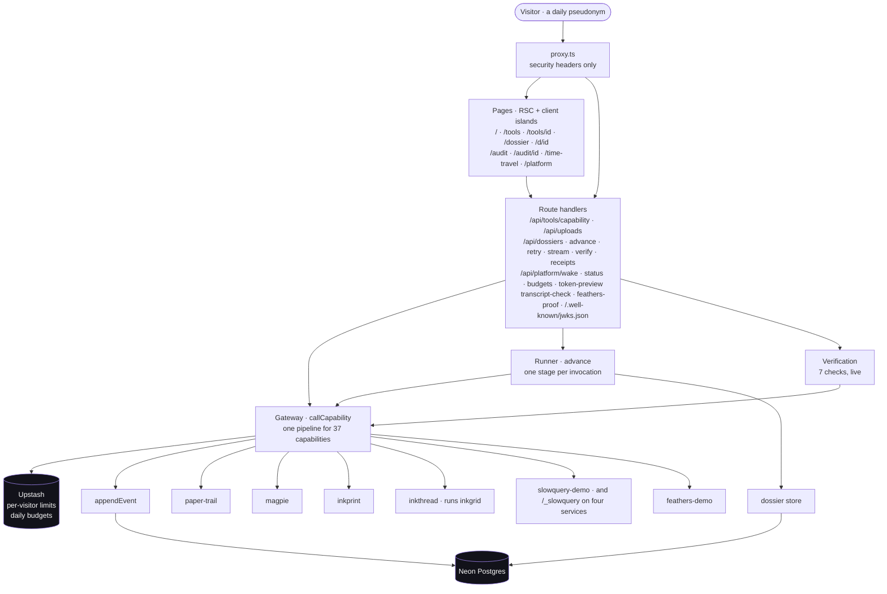
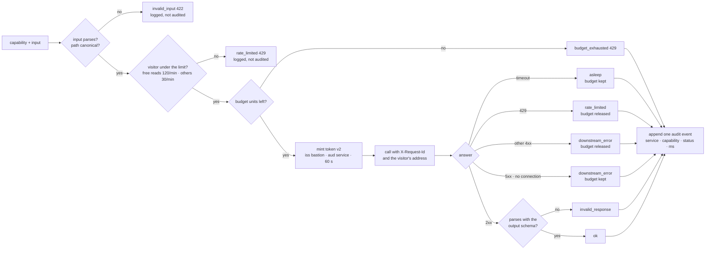
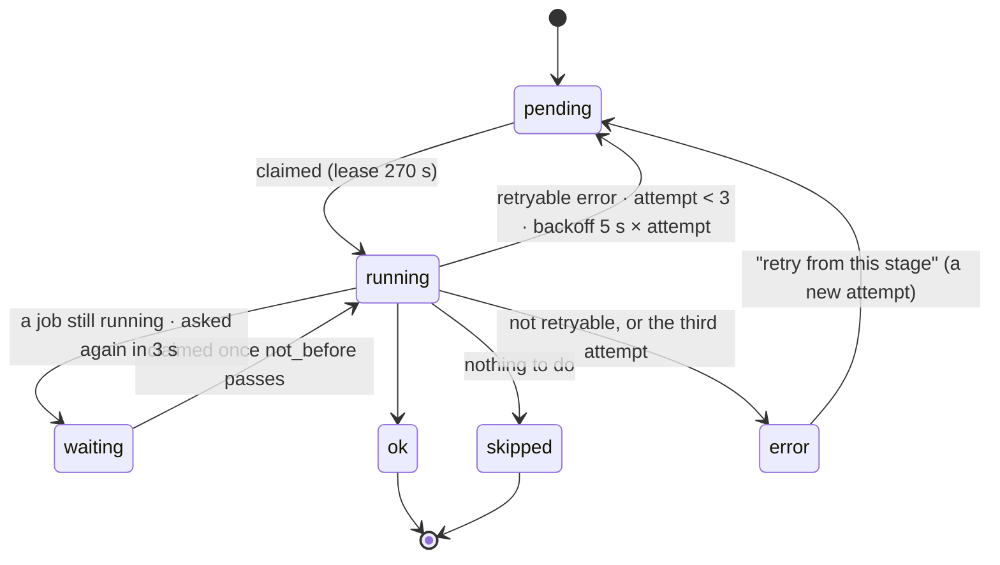
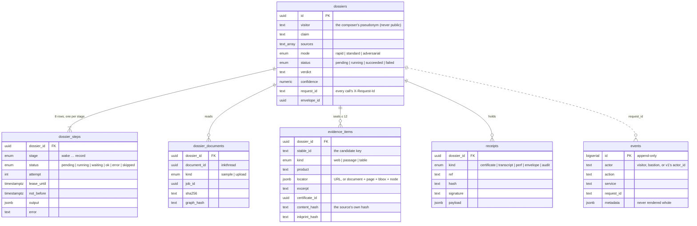
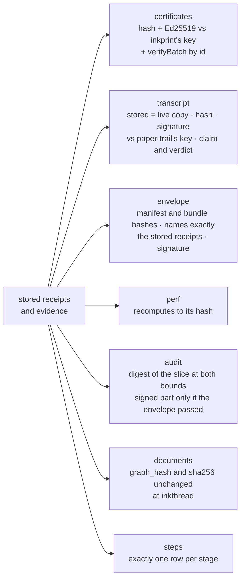

# Architecture

bastion v2 is one Next.js 16 application on Vercel: server-rendered pages, route handlers, and a
durable runner, in front of the six services the portfolio's eight products run on. There is no
sign-in and no separate backend. The design and every rule live in
[`specs/21-bastion-v2.md`](specs/21-bastion-v2.md); the token every service checks is
[`specs/22-platform-contract-v2.md`](specs/22-platform-contract-v2.md).

## System overview



## Component map

| Component | Responsibility | Key files |
|---|---|---|
| Proxy | Sets the security headers on every response (one list shared with `next.config.ts`); gates nothing | `src/proxy.ts`, `src/platform/security-headers.ts` |
| Visitor and secrets | The daily pseudonym (`v_` + 10 base32 of HMAC(ip ‖ UTC date)); every key derived from `IRON_SESSION_PASSWORD` with HKDF | `src/platform/visitor.ts`, `src/platform/secrets.ts` |
| Registry | The 8 products, 15 repos and 6 services; base URLs (https only); health probes, wake, the shared 30 s status round | `src/platform/registry/*` |
| Capabilities | One module per product: input schema, path, the grant, cost class, budget, timeout, the output schema | `src/capabilities/*` |
| Gateway | The one call pipeline: limit → budget → token → call → parse → audit → typed result | `src/platform/gateway/call.ts`, `token.ts`, `keys.ts`, `result.ts` |
| Budgets and limits | Daily counters per UTC day; sliding windows per visitor | `src/platform/budget.ts`, `src/platform/ratelimit.ts` |
| Audit | `appendEvent`, the log's readers, request trails, time-travel replay | `src/platform/audit/*`, `src/features/audit/*`, `src/lib/audit/replay.ts` |
| Dossier | Compose, the runner and its 8 stages, evidence selection, receipts, verification, the bundle | `src/dossier/*`, `src/dossier/stages/*` |
| Workbenches | One client workbench per product behind a wake gate and its budgets | `src/features/tools/*`, `src/components/tools/*` |
| Pages | The map, compose, the live dossier and its receipt, the open log, the registry | `src/app/**/page.tsx`, `src/features/*` |
| Schema | Drizzle tables; the append-only triggers and the v2 tables ship as migrations | `src/lib/db/schema.ts`, `drizzle/*.sql`, `scripts/migrate.mjs` |

## The gateway pipeline



Redirects are never followed (they would carry the token). The runner and verification call as
the system actor `bastion`, outside the per-visitor limits; every stage's call carries the
dossier's own request id, which is how the measure stage finds the dossier's queries in each
service.

## The runner

A dossier is one `dossiers` row and eight `dossier_steps` rows, created with its documents in one
transaction. `POST /api/dossiers/[id]/advance` claims the next runnable stage atomically
(`UPDATE … WHERE lease_until < now() AND not_before <= now() … RETURNING`), runs that one stage
within a 240 s budget under a 270 s lease, records the outcome and the dossier's status in one
transaction, and answers. A second caller finds nothing to claim.



**Chaining.** Before the stage runs, the route registers the hand-off to the next invocation with
`after()`, as a promise that settles once the stage is recorded: the next delay (now, or the 3 s
of a waiting poll), or nothing to chain. The hand-off POSTs the same route with an internal HMAC
header (so the runner never meets the visitor rate limit) and lets go after 10 s. Registering it
first matters: a stage longer than that runs with its caller already gone, and Next runs a
*function* given to `after()` only when the response closes — a close that has already happened.
A promise is kept alive with `waitUntil` instead. The e2e suite crosses a 12 s stage with no page
open to prove the chain holds.

**Recovery.** The dossier page nudges `advance` when its frontier stage has been due for 5 s
(a lease that expired, a `not_before` that passed), backing off on failure; a crashed invocation's
stage becomes claimable again when its lease ends. A wait capped at 15 minutes becomes an error.

**Progress.** `GET /api/dossiers/[id]/stream` polls the rows every 2 s and sends `step`, `status`,
`done`, `heartbeat` and `timeout` events, reading only scalar columns and a few small projections
of each stage's output (never the output itself), and ends before `maxDuration`.

## Data model

Migration `0002` is additive: v1's `users`, `sessions`, `magic_links` and `dossier_events` stay as
history until a later, destructive migration.



## Verification

`POST /api/dossiers/[id]/verify` (5 a minute per visitor, at most 120 s, no budget) runs seven
checks under its own request id and appends one `dossier.verified` event with their states. Each
check is pass, fail, unavailable (the issuer could not be asked — never a pass) or expired (an
upload's graph, gone by design).



A receipt the dossier implies but does not hold is a fail, so deleting a row cannot hide a check.
The issuers sign Python's `json.dumps(sort_keys=True)` bytes; bastion rebuilds them
(`src/platform/python-json.ts`, `src/dossier/issuer-forms.ts`), and its own receipts are hashed
over RFC 8785 canonical JSON (`src/platform/canonical-json.ts`).

## Health and waking

A health probe times out at 8 s and reports **asleep** (a cold Render service), not down; a refused
connection or a 5xx reports **down**. `GET /api/platform/status` shares one probe round for 30 s
with every visitor (Upstash when configured, in-process otherwise). A workbench's gate calls
`POST /api/platform/wake/<service>`, which holds the probe open for up to 90 s, retrying a timeout,
502 or 503; the gate shows checking → waking (seconds counting) → the route's own answer, and keeps
every action disabled until every service is live.

## Security invariants

1. No sign-in and no cookies. A visitor is a daily, irreversible pseudonym; it is the token `sub`,
   the rate-limit key and the audit actor.
2. bastion holds two secrets of its own — the root secret and the Ed25519 signing key — beside the
   database URL and the Upstash token. Every other key is HKDF-derived from the root secret with a
   purpose label (the visitor ids, the runner's advance tokens).
3. Every downstream call goes through the gateway. Each token is Ed25519, bound to `iss: bastion` and
   one `aud`, lives 60 s and names its capability; backends fail closed without a key (spec 22).
4. Every downstream answer is parsed with the capability's schema; a body that does not parse is
   `invalid_response`, never a crash and never a cast.
5. Spending is bounded twice: per-visitor rate limits on a visitor's calls to a service, spends and
   reads of the log, and daily budgets shared by everyone. A reservation increments first and rolls
   back past the limit, so concurrent callers can never overspend; a budget store that is
   configured but unreachable refuses.
6. `events` is append-only in Postgres: `UPDATE`, `DELETE` and `TRUNCATE` are revoked and rejected
   by triggers for every role, the owner included (`drizzle/0001_append_only_events.sql`, proven by
   `tests/integration/db/append-only.test.ts`). Each envelope signs the digest of its dossier's slice.
7. No page sends an event's raw metadata, `before` or `after` to the browser; an internal error is
   published as its bare code.
8. Verification checks signatures against the key each issuer publishes now, never one the dossier
   carries, and never reports what it could not check as a pass.
9. Uploads are at most 4 MB and must start with `%PDF-`; inkthread processes them and keeps no bytes.
10. The CSP restricts sources and drops `'unsafe-eval'` in production; `'unsafe-inline'` stays until
    a nonce pipeline exists (DR-0018). `X-Frame-Options: DENY`, `nosniff`, `frame-ancestors 'none'`.

## Layering

```
proxy.ts (headers)
  → pages (RSC: render, read) and client islands (call route handlers only)
    → route handlers (thin: parse the request, limit it, call one module, map the result)
      → gateway · runner · verification · audit (the only modules that do I/O)
        → capability table and pure cores (schemas, selection, receipt math, canonical JSON)
          → Drizzle schema → Neon Postgres (append-only triggers own the log's guarantee)
```

Stages are handlers over injected calls, so each is unit-tested without a network; the store
adapters are tested against a real Postgres; the composed flows are tested end to end against a
stub of every service (`tests/e2e/`).
