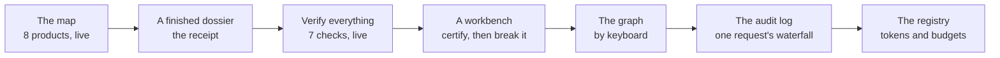

# Demo: a two-minute path for a reviewer

No sign-in, nothing to install. Every step below works for any visitor; only the optional last one
spends anything (one of today's debates).



Open **https://bastion-six.vercel.app**. The products run on Render's free tier: a service asleep
for 15 minutes takes about a minute to wake, and the pages say "asleep" or "waking" while it does —
reading a finished dossier needs no service at all, so start there.

## 1. The map (15 s) — `/`

- The system map draws the eight products and the dossier's flows between them. Each node says its
  state in words (live, asleep, down), checked for every visitor at once every 30 s.
- Below it, **recent receipts**: the last finished dossiers. Open one.

## 2. A finished dossier (35 s) — `/d/<id>`

- The claim, the verdict stamp and its confidence.
- **Evidence**: each row is a web item (magpie) or a PDF passage or table (inkthread, inkgrid), with
  its excerpt and its inkprint certificate.
- **The debate**: paper-trail's rounds; its proponent, skeptic and judge argue over that signed
  evidence first, and every `[cert:…]` citation links to the evidence row it rests on. paper-trail
  may search the web for what the pool cannot answer; those citations are URLs, linked out.
- **Documents**: "show on its pages" draws each quoted passage as a box on its PDF page.
- **The queries it caused**: what each service ran for this dossier's request id, with any exact
  `CREATE INDEX`.
- **The seal**: inkprint's envelope over all of the above, and the digest of the dossier's slice of
  the audit log.

## 3. Verify everything (15 s)

- Press **verify everything**. bastion fetches each issuer's published key and re-checks every
  signature and hash live: certificates, transcript, envelope, perf, audit, documents, steps.
- Each check says pass, fail, unavailable (the issuer could not be asked — never a pass) or expired.
- **download receipts** saves the whole bundle as canonical JSON — every receipt, the evidence and
  the audit events the digests cover — so each hash, signature and digest can be recomputed
  without bastion.

## 4. A workbench (25 s) — `/tools/inkprint`

- The wake gate shows inkprint waking, then live; the actions unlock only then.
- **certify** the sample text: an Ed25519 certificate with its C2PA manifest, a copy button and the
  call's audit link.
- **load it**, then **verify**: valid. Change one word in the text and **verify** again: invalid,
  with the failing check named.

## 5. The graph, by keyboard (15 s) — `/tools/inkthread`

- Tab once into the graph, move with the arrow keys, press Enter on an element: its why (the rule or
  model that made it) and its page with the element boxed.

## 6. The audit log (10 s) — `/audit`

- Every gateway call and every dossier stage, newest first, append-only in Postgres itself.
- Open a request id: its waterfall across services, every bar on one time scale.

## 7. The registry (5 s) — `/platform`

- The 8 products, 15 repos and 6 services with their live health and commit SHAs; the token
  contract (EdDSA, the key id, one audience per service, 60 s); today's budgets.

## Optional: run your own dossier — `/dossier`

- A claim, a magpie source or an inkthread sample (or a PDF up to 4 MB), a mode. **run the dossier**
  spends one of today's debates and opens its public page, which follows the eight stages live.
  The run does not need the page open: close it and come back to the same URL (only a stage that
  overruns its 240 s budget waits for an open page to nudge it on).

## Talking points

- **No sign-in, still bounded**: a daily pseudonym, per-visitor rate limits, daily budgets shared by
  everyone — the free model quota is 50 requests a day across the portfolio.
- **One door**: every call to every product goes through one gateway with a token bound to one
  audience, and lands in the append-only log.
- **Durable**: a dossier is eight Postgres rows advanced one stage per invocation; it finishes with
  the page closed.
- **Verifiable**: nothing is taken on bastion's word; every receipt is re-checked against the
  service that issued it.

## Before v2 is deployed

The live site serves v1 until the six backends ship contract v2 (spec 22 §5). The same path runs
locally against a stub of every service, in a visible browser:

```bash
pnpm build
DATABASE_URL=postgresql://…@localhost:5432/bastion_e2e node scripts/migrate.mjs --force
DATABASE_URL=postgresql://…@localhost:5432/bastion_e2e pnpm exec playwright test --headed
```
